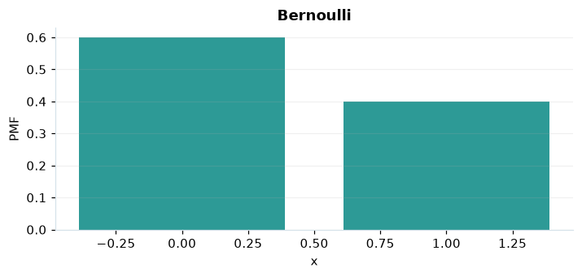

# Bernoulli

## Definición formal

Un único ensayo binario: $X=1$ si hay éxito y $X=0$ si hay fracaso.

## Parámetros y rango

| Parámetro | Significado | Valores admitidos | Ejemplo |
|---|---|---|---|
| `p` | Probabilidad de éxito | ≥ 0 y ≤ 1 | 0,4 |

## Función de masa (PMF)

$$
P(X=x)=\begin{cases}p^x(1-p)^{1-x},&x\in\{0,1\}\\0,&\mathrm{en\ otro\ caso}\end{cases}
$$

## Función de distribución acumulada (CDF)

$$
F(x)=\begin{cases}0,&x<0\\1-p,&0\le x<1\\1,&x\ge1\end{cases}
$$

La acumulada $F(x)=P(X\le x)$ suma las masas hasta $x$. Para enteros $a\le b$, $P(a\le X\le b)=F(b)-F(a-1)$.

## Media, varianza y desviación estándar

$$
\begin{aligned}\operatorname{E}[X]&=p\\[4pt]\operatorname{Var}(X)&=p(1-p)\\[4pt]\sigma_X&=\sqrt{\operatorname{Var}(X)}\end{aligned}
$$

## Propiedades y casos especiales

Los límites $p=0$ y $p=1$ son casos degenerados. Es la binomial con $n=1$.

*Figura 1. Bernoulli: representación ilustrativa de la función de masa.*

## Ejemplo resuelto, paso a paso

1. **Datos.** Usa `p` = 0,4 y evalúa el punto $x=1$.
2. **Sustitución.** $P(X=1)=0{,}4^1\,0{,}6^0$. La masa es **0,4**.
3. **Acumulada.** $F(1)=P(X\le 1)$ ≈ **1**.
4. **Interpretación.** La masa del paso 2 es la probabilidad de observar exactamente 1. La acumulada incluye también todos los valores menores.

## Referencias

- Ross, S. M. (2019). *A First Course in Probability* (10.ª ed.). Pearson.
- Casella, G., & Berger, R. L. (2002). *Statistical Inference* (2.ª ed.). Duxbury.
- Virtanen, P., et al. (2020). SciPy 1.0: Fundamental algorithms for scientific computing in Python. *Nature Methods, 17*, 261–272. https://doi.org/10.1038/s41592-019-0686-2
