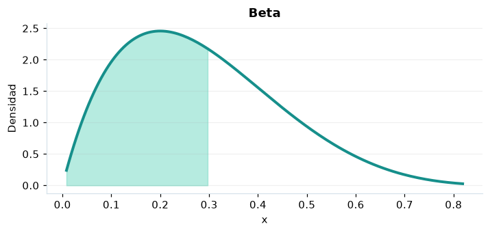

# Beta

## Definición formal

Familia flexible de probabilidades/proporciones en el intervalo unitario.

## Parámetros y rango

| Parámetro | Significado | Valores admitidos | Ejemplo |
|---|---|---|---|
| `alpha` | Forma α | > 0 | 2 |
| `beta` | Forma β | > 0 | 5 |

## Función de densidad (PDF)

$$
f(x)=\frac{x^{\alpha-1}(1-x)^{\beta-1}}{B(\alpha,\beta)},\quad 0<x<1
$$

## Función de distribución acumulada (CDF)

$$
F(x)=I_x(\alpha,\beta)
$$

La acumulada es $F(x)=P(X\le x)$. Para un intervalo, $P(a\le X\le b)=F(b)-F(a)$. La densidad $f(x)$ no es una probabilidad puntual: $P(X=x)=0$.

## Media, varianza y desviación estándar

$$
\begin{aligned}\operatorname{E}[X]&=\frac{\alpha}{\alpha+\beta}\\[4pt]\operatorname{Var}(X)&=\frac{\alpha\beta}{(\alpha+\beta)^2(\alpha+\beta+1)}\\[4pt]\sigma_X&=\sqrt{\operatorname{Var}(X)}\end{aligned}
$$

## Propiedades y casos especiales

$\alpha=\beta=1$ recupera la uniforme $(0,1)$. Conjugada de Bernoulli/binomial en inferencia bayesiana.

*Figura 1. Beta: representación ilustrativa de la función de densidad.*

## Ejemplo resuelto, paso a paso

1. **Datos.** Usa `alpha` = 2, `beta` = 5 y evalúa el punto $x=0{,}3$.
2. **Sustitución.** $f(0{,}3)=30(0{,}3)(0{,}7)^4$. La densidad es **2,1609**.
3. **Acumulada.** $F(0{,}3)=P(X\le 0{,}3)$ ≈ **0,579825**.
4. **Interpretación.** La probabilidad de no superar 0,3 es aproximadamente 57,98 %. Para una probabilidad entre dos puntos, resta sus acumuladas.

## Referencias

- Ross, S. M. (2019). *A First Course in Probability* (10.ª ed.). Pearson.
- Casella, G., & Berger, R. L. (2002). *Statistical Inference* (2.ª ed.). Duxbury.
- Virtanen, P., et al. (2020). SciPy 1.0: Fundamental algorithms for scientific computing in Python. *Nature Methods, 17*, 261–272. https://doi.org/10.1038/s41592-019-0686-2
