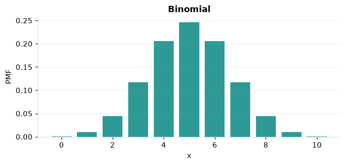

# Binomial

## Definición formal

Cuenta éxitos en $n$ ensayos de Bernoulli independientes con probabilidad común $p$.

## Parámetros y rango

| Parámetro | Significado | Valores admitidos | Ejemplo |
|---|---|---|---|
| `n` | Ensayos independientes | Entero, ≥ 0 | 10 |
| `p` | Probabilidad de éxito | ≥ 0 y ≤ 1 | 0,5 |

## Función de masa (PMF)

$$
P(X=x)=\begin{cases}\binom{n}{x}p^x(1-p)^{n-x},&x\in\{0,\ldots,n\}\\0,&\mathrm{en\ otro\ caso}\end{cases}
$$

## Función de distribución acumulada (CDF)

$$
F(x)=\sum_{k=0}^{\lfloor x\rfloor}\binom{n}{k}p^k(1-p)^{n-k}
$$

La acumulada $F(x)=P(X\le x)$ suma las masas hasta $x$. Para enteros $a\le b$, $P(a\le X\le b)=F(b)-F(a-1)$.

## Media, varianza y desviación estándar

$$
\begin{aligned}\operatorname{E}[X]&=np\\[4pt]\operatorname{Var}(X)&=np(1-p)\\[4pt]\sigma_X&=\sqrt{\operatorname{Var}(X)}\end{aligned}
$$

## Propiedades y casos especiales

$p=0$ o $p=1$ dan resultados deterministas. Para $n$ grande y $np,n(1-p)$ suficientes se usa la aproximación normal.

*Figura 1. Binomial: representación ilustrativa de la función de masa.*

## Ejemplo resuelto, paso a paso

1. **Datos.** Usa `n` = 10, `p` = 0,5 y evalúa el punto $x=5$.
2. **Sustitución.** $P(X=5)=\binom{10}{5}(0{,}5)^{10}$. La masa es **0,246094**.
3. **Acumulada.** $F(5)=P(X\le 5)$ ≈ **0,623047**.
4. **Interpretación.** La masa del paso 2 es la probabilidad de observar exactamente 5. La acumulada incluye también todos los valores menores.

## Referencias

- Ross, S. M. (2019). *A First Course in Probability* (10.ª ed.). Pearson.
- Casella, G., & Berger, R. L. (2002). *Statistical Inference* (2.ª ed.). Duxbury.
- Virtanen, P., et al. (2020). SciPy 1.0: Fundamental algorithms for scientific computing in Python. *Nature Methods, 17*, 261–272. https://doi.org/10.1038/s41592-019-0686-2
