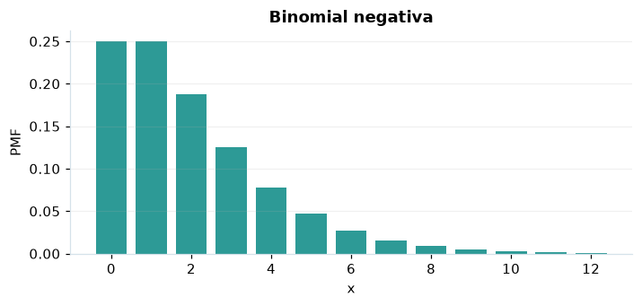

# Binomial negativa

## Definición formal

Cuenta el número de **fracasos** antes de alcanzar el éxito número $r$.

## Parámetros y rango

| Parámetro | Significado | Valores admitidos | Ejemplo |
|---|---|---|---|
| `r` | Número de éxitos objetivo | Entero, ≥ 1 | 2 |
| `p` | Probabilidad de éxito | > 0 y ≤ 1 | 0,5 |

## Función de masa (PMF)

$$
P(X=x)=\binom{r+x-1}{x}p^r(1-p)^x,\quad x=0,1,\ldots
$$

## Función de distribución acumulada (CDF)

$$
F(x)=\sum_{k=0}^{\lfloor x\rfloor}\binom{r+k-1}{k}p^r(1-p)^k
$$

La acumulada $F(x)=P(X\le x)$ suma las masas hasta $x$. Para enteros $a\le b$, $P(a\le X\le b)=F(b)-F(a-1)$.

## Media, varianza y desviación estándar

$$
\begin{aligned}\operatorname{E}[X]&=\frac{r(1-p)}{p}\\[4pt]\operatorname{Var}(X)&=\frac{r(1-p)}{p^2}\\[4pt]\sigma_X&=\sqrt{\operatorname{Var}(X)}\end{aligned}
$$

## Propiedades y casos especiales

Con $r=1$ se convierte en geométrica de fracasos (que difiere en 1 de la geométrica de intentos). $p=1$ produce siempre 0 fracasos.

*Figura 1. Binomial negativa: representación ilustrativa de la función de masa.*

## Ejemplo resuelto, paso a paso

1. **Datos.** Usa `r` = 2, `p` = 0,5 y evalúa el punto $x=3$.
2. **Sustitución.** $P(X=3)=\binom{4}{3}(0{,}5)^5$. La masa es **0,125**.
3. **Acumulada.** $F(3)=P(X\le 3)$ ≈ **0,8125**.
4. **Interpretación.** La masa del paso 2 es la probabilidad de observar exactamente 3. La acumulada incluye también todos los valores menores.

## Referencias

- Ross, S. M. (2019). *A First Course in Probability* (10.ª ed.). Pearson.
- Casella, G., & Berger, R. L. (2002). *Statistical Inference* (2.ª ed.). Duxbury.
- Virtanen, P., et al. (2020). SciPy 1.0: Fundamental algorithms for scientific computing in Python. *Nature Methods, 17*, 261–272. https://doi.org/10.1038/s41592-019-0686-2
