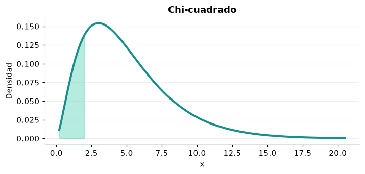

# Chi-cuadrado

## Definición formal

Para $\nu$ entero positivo, es la suma de cuadrados de $\nu$ normales estándar independientes. Su extensión a cualquier $\nu>0$ es una gamma de forma $\nu/2$ y escala 2.

## Parámetros y rango

| Parámetro | Significado | Valores admitidos | Ejemplo |
|---|---|---|---|
| `gl` | Grados de libertad | > 0 | 5 |

## Función de densidad (PDF)

$$
f(x)=\frac{x^{\nu/2-1}e^{-x/2}}{2^{\nu/2}\Gamma(\nu/2)},\quad x>0
$$

## Función de distribución acumulada (CDF)

$$
F(x)=\frac{\gamma(\nu/2,x/2)}{\Gamma(\nu/2)}
$$

La acumulada es $F(x)=P(X\le x)$. Para un intervalo, $P(a\le X\le b)=F(b)-F(a)$. La densidad $f(x)$ no es una probabilidad puntual: $P(X=x)=0$.

## Media, varianza y desviación estándar

$$
\begin{aligned}\operatorname{E}[X]&=\nu\\[4pt]\operatorname{Var}(X)&=2\nu\\[4pt]\sigma_X&=\sqrt{\operatorname{Var}(X)}\end{aligned}
$$

## Propiedades y casos especiales

Es una gamma con forma $\nu/2$ y escala 2. Para $\nu=1$, la densidad diverge en cero pero la integral es finita.

*Figura 1. Chi-cuadrado: representación ilustrativa de la función de densidad.*

## Ejemplo resuelto, paso a paso

1. **Datos.** Usa `gl` = 5 y evalúa el punto $x=2$.
2. **Sustitución.** $f(2)=e^{-1}/[2\Gamma(5/2)]$. La densidad es **0,138369**.
3. **Acumulada.** $F(2)=P(X\le 2)$ ≈ **0,150855**.
4. **Interpretación.** La probabilidad de no superar 2 es aproximadamente 15,09 %. Para una probabilidad entre dos puntos, resta sus acumuladas.

## Referencias

- Ross, S. M. (2019). *A First Course in Probability* (10.ª ed.). Pearson.
- Casella, G., & Berger, R. L. (2002). *Statistical Inference* (2.ª ed.). Duxbury.
- Virtanen, P., et al. (2020). SciPy 1.0: Fundamental algorithms for scientific computing in Python. *Nature Methods, 17*, 261–272. https://doi.org/10.1038/s41592-019-0686-2
