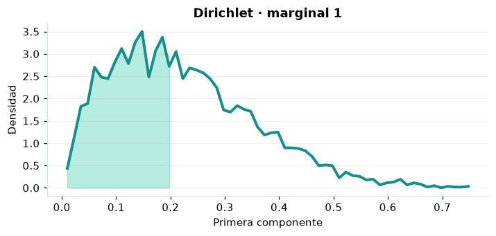

# Dirichlet

## Definición formal

Distribución de un vector de proporciones positivas que suman exactamente uno.

## Parámetros y rango

| Parámetro | Significado | Valores admitidos | Ejemplo |
|---|---|---|---|
| `alpha` | Concentraciones positivas | Cada componente: > 0 | (2; 3; 4) |

Cada concentración es positiva. El vector observado tiene componentes positivos que suman 1. En los campos vectoriales separa los componentes con espacios: `0,2 0,3 0,5`.

## Función de densidad (PDF)

$$
f(\boldsymbol x)=\frac{\Gamma(\alpha_0)}{\prod_i\Gamma(\alpha_i)}\prod_i x_i^{\alpha_i-1},\quad\alpha_0=\sum_i\alpha_i,\ \sum_i x_i=1
$$

## Función de distribución acumulada (CDF)

$$
F_i(t)=I_t(\alpha_i,\alpha_0-\alpha_i)
$$

Cada $F_i(t)=P(X_i\le t)$ es una **acumulada marginal**. No es la acumulada conjunta del vector.

## Media, varianza y desviación estándar

$$
\begin{aligned}\operatorname{E}[X_i]&=\frac{\alpha_i}{\alpha_0}\\[4pt]\operatorname{Var}(X_i)&=\frac{\alpha_i(\alpha_0-\alpha_i)}{\alpha_0^2(\alpha_0+1)}\\[4pt]\sigma_{X_i}&=\sqrt{\operatorname{Var}(X_i)}\end{aligned}
$$

Los momentos se interpretan **por componente**; la dependencia entre componentes se describe mediante sus covarianzas.

## Propiedades y casos especiales

Sus marginales son beta; la CDF/PPF de AmPu son **marginales**, no conjuntas. Para dos componentes equivale a una beta. La densidad conjunta puede superar 1: no es una probabilidad puntual.

*Figura 1. Primera marginal de Dirichlet; no representa la función conjunta.*

## Ejemplo resuelto, paso a paso

1. **Datos.** Usa `alpha` = (2; 3; 4) y evalúa el punto $\boldsymbol{x}=\left(0{,}2;\,0{,}3;\,0{,}5\right)$.
2. **Sustitución.** $f(\boldsymbol{x})=3360(0{,}2)(0{,}3)^2(0{,}5)^3$. La densidad es **7,56**.
3. **Acumulada.** Las acumuladas marginales, en el orden de los componentes, son **(0,496684; 0,448226; 0,636719)**.
4. **Interpretación.** La función del paso 2 es conjunta; las acumuladas del paso 3 son marginales. No las multipliques como si los componentes fueran independientes.

## Referencias

- Ross, S. M. (2019). *A First Course in Probability* (10.ª ed.). Pearson.
- Casella, G., & Berger, R. L. (2002). *Statistical Inference* (2.ª ed.). Duxbury.
- Virtanen, P., et al. (2020). SciPy 1.0: Fundamental algorithms for scientific computing in Python. *Nature Methods, 17*, 261–272. https://doi.org/10.1038/s41592-019-0686-2
