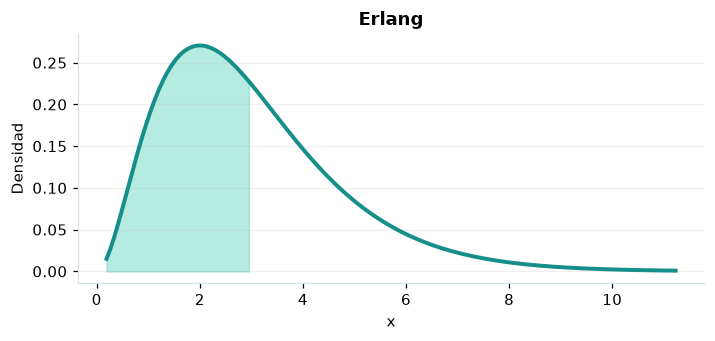

# Erlang

## Definición formal

Suma de $k$ esperas exponenciales independientes con la misma tasa $\lambda$; $k$ entero.

## Parámetros y rango

| Parámetro | Significado | Valores admitidos | Ejemplo |
|---|---|---|---|
| `k` | Etapas de espera | Entero, ≥ 1 | 3 |
| `tasa` | Tasa λ | > 0 | 1 |

## Función de densidad (PDF)

$$
f(x)=\frac{\lambda^k x^{k-1}e^{-\lambda x}}{(k-1)!},\quad x\ge0
$$

## Función de distribución acumulada (CDF)

$$
F(x)=1-e^{-\lambda x}\sum_{j=0}^{k-1}\frac{(\lambda x)^j}{j!}
$$

La acumulada es $F(x)=P(X\le x)$. Para un intervalo, $P(a\le X\le b)=F(b)-F(a)$. La densidad $f(x)$ no es una probabilidad puntual: $P(X=x)=0$.

## Media, varianza y desviación estándar

$$
\begin{aligned}\operatorname{E}[X]&=\frac{k}{\lambda}\\[4pt]\operatorname{Var}(X)&=\frac{k}{\lambda^2}\\[4pt]\sigma_X&=\sqrt{\operatorname{Var}(X)}\end{aligned}
$$

## Propiedades y casos especiales

Es gamma con forma entera $k$; $k=1$ produce una exponencial.

*Figura 1. Erlang: representación ilustrativa de la función de densidad.*

## Ejemplo resuelto, paso a paso

1. **Datos.** Usa `k` = 3, `tasa` = 1 y evalúa el punto $x=3$.
2. **Sustitución.** $f(3)=3^2e^{-3}/2$. La densidad es **0,224042**.
3. **Acumulada.** $F(3)=P(X\le 3)$ ≈ **0,57681**.
4. **Interpretación.** La probabilidad de no superar 3 es aproximadamente 57,68 %. Para una probabilidad entre dos puntos, resta sus acumuladas.

## Referencias

- Ross, S. M. (2019). *A First Course in Probability* (10.ª ed.). Pearson.
- Casella, G., & Berger, R. L. (2002). *Statistical Inference* (2.ª ed.). Duxbury.
- Virtanen, P., et al. (2020). SciPy 1.0: Fundamental algorithms for scientific computing in Python. *Nature Methods, 17*, 261–272. https://doi.org/10.1038/s41592-019-0686-2
