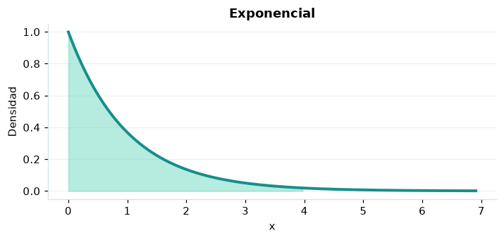

# Exponencial

## Definición formal

Tiempo de espera no negativo hasta un suceso de un proceso de Poisson con tasa $\lambda$.

## Parámetros y rango

| Parámetro | Significado | Valores admitidos | Ejemplo |
|---|---|---|---|
| `tasa` | Tasa de eventos λ | > 0 | 1 |

## Función de densidad (PDF)

$$
f(x)=\begin{cases}\lambda e^{-\lambda x},&x\ge0\\0,&x<0\end{cases}
$$

## Función de distribución acumulada (CDF)

$$
F(x)=\begin{cases}1-e^{-\lambda x},&x\ge0\\0,&x<0\end{cases}
$$

La acumulada es $F(x)=P(X\le x)$. Para un intervalo, $P(a\le X\le b)=F(b)-F(a)$. La densidad $f(x)$ no es una probabilidad puntual: $P(X=x)=0$.

## Media, varianza y desviación estándar

$$
\begin{aligned}\operatorname{E}[X]&=\frac1\lambda\\[4pt]\operatorname{Var}(X)&=\frac1{\lambda^2}\\[4pt]\sigma_X&=\sqrt{\operatorname{Var}(X)}\end{aligned}
$$

## Propiedades y casos especiales

Sin memoria: $P(X>s+t\mid X>s)=P(X>t)$. Su cola estable es $S(x)=e^{-\lambda x}$ para $x\ge0$.

*Figura 1. Exponencial: representación ilustrativa de la función de densidad.*

## Ejemplo resuelto, paso a paso

1. **Datos.** Usa `tasa` = 1 y evalúa el punto $x=4$.
2. **Sustitución.** $f(4)=e^{-4}$. La densidad es **0,018316**.
3. **Acumulada.** $F(4)=P(X\le 4)$ ≈ **0,981684**.
4. **Interpretación.** La probabilidad de no superar 4 es aproximadamente 98,17 %. Para una probabilidad entre dos puntos, resta sus acumuladas.

## Referencias

- Ross, S. M. (2019). *A First Course in Probability* (10.ª ed.). Pearson.
- Casella, G., & Berger, R. L. (2002). *Statistical Inference* (2.ª ed.). Duxbury.
- Virtanen, P., et al. (2020). SciPy 1.0: Fundamental algorithms for scientific computing in Python. *Nature Methods, 17*, 261–272. https://doi.org/10.1038/s41592-019-0686-2
