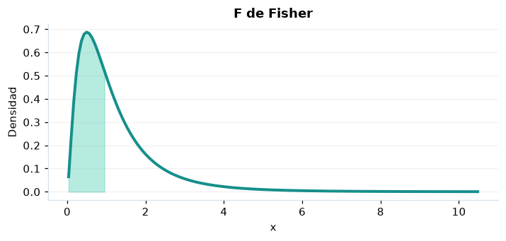

# F de Fisher

## Definición formal

Cociente de dos chi-cuadrados independientes normalizados por sus grados de libertad $d_1,d_2$.

## Parámetros y rango

| Parámetro | Significado | Valores admitidos | Ejemplo |
|---|---|---|---|
| `gl1` | Grados de libertad del numerador | > 0 | 5 |
| `gl2` | Grados de libertad del denominador | > 0 | 10 |

## Función de densidad (PDF)

$$
f(x)=\frac{(d_1/d_2)^{d_1/2}x^{d_1/2-1}}{B(d_1/2,d_2/2)(1+d_1x/d_2)^{(d_1+d_2)/2}},\quad x>0
$$

## Función de distribución acumulada (CDF)

$$
F(x)=I_{d_1x/(d_1x+d_2)}(d_1/2,d_2/2)
$$

La acumulada es $F(x)=P(X\le x)$. Para un intervalo, $P(a\le X\le b)=F(b)-F(a)$. La densidad $f(x)$ no es una probabilidad puntual: $P(X=x)=0$.

## Media, varianza y desviación estándar

$$
\begin{aligned}\operatorname{E}[X]&=\frac{d_2}{d_2-2}\ (d_2>2)\\[4pt]\operatorname{Var}(X)&=\frac{2d_2^2(d_1+d_2-2)}{d_1(d_2-2)^2(d_2-4)}\ (d_2>4)\\[4pt]\sigma_X&=\sqrt{\operatorname{Var}(X)}\end{aligned}
$$

Los momentos solo existen bajo las condiciones indicadas; si la varianza no existe, la desviación estándar tampoco está definida.

## Propiedades y casos especiales

La cola derecha es habitual en ANOVA. En SciPy los grados de libertad son parámetros, no constantes hardcodeadas.

*Figura 1. F de Fisher: representación ilustrativa de la función de densidad.*

## Ejemplo resuelto, paso a paso

1. **Datos.** Usa `gl1` = 5, `gl2` = 10 y evalúa el punto $x=1$.
2. **Sustitución.** Sustituye los grados de libertad y $x=1$ en la PDF: **0,49548**. Para la CDF, usa $u=\frac{5\cdot1}{5\cdot1+10}=\frac13$ en la beta incompleta regularizada.
3. **Acumulada.** $F(1)=P(X\le 1)$ ≈ **0,534881**.
4. **Interpretación.** La probabilidad de no superar 1 es aproximadamente 53,49 %. Para una probabilidad entre dos puntos, resta sus acumuladas.

## Referencias

- Ross, S. M. (2019). *A First Course in Probability* (10.ª ed.). Pearson.
- Casella, G., & Berger, R. L. (2002). *Statistical Inference* (2.ª ed.). Duxbury.
- Virtanen, P., et al. (2020). SciPy 1.0: Fundamental algorithms for scientific computing in Python. *Nature Methods, 17*, 261–272. https://doi.org/10.1038/s41592-019-0686-2
