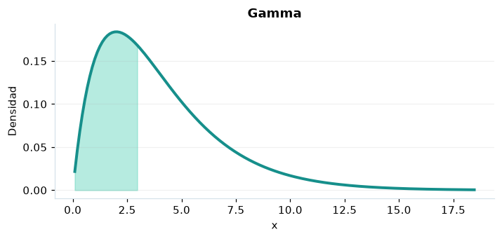

# Gamma

## Definición formal

Tiempo de espera general positivo de forma $k$ y escala $\theta$.

## Parámetros y rango

| Parámetro | Significado | Valores admitidos | Ejemplo |
|---|---|---|---|
| `forma` | Forma k | > 0 | 2 |
| `escala` | Escala θ | > 0 | 2 |

## Función de densidad (PDF)

$$
f(x)=\frac{x^{k-1}e^{-x/\theta}}{\Gamma(k)\theta^k},\quad x>0
$$

## Función de distribución acumulada (CDF)

$$
F(x)=\frac{\gamma(k,x/\theta)}{\Gamma(k)}
$$

La acumulada es $F(x)=P(X\le x)$. Para un intervalo, $P(a\le X\le b)=F(b)-F(a)$. La densidad $f(x)$ no es una probabilidad puntual: $P(X=x)=0$.

## Media, varianza y desviación estándar

$$
\begin{aligned}\operatorname{E}[X]&=k\theta\\[4pt]\operatorname{Var}(X)&=k\theta^2\\[4pt]\sigma_X&=\sqrt{\operatorname{Var}(X)}\end{aligned}
$$

## Propiedades y casos especiales

Para $k=1$ es exponencial con tasa $1/\theta$; para $k=\nu/2,\theta=2$ es chi-cuadrado.

*Figura 1. Gamma: representación ilustrativa de la función de densidad.*

## Ejemplo resuelto, paso a paso

1. **Datos.** Usa `forma` = 2, `escala` = 2 y evalúa el punto $x=3$.
2. **Sustitución.** $f(3)=3e^{-3/2}/4$. La densidad es **0,167348**.
3. **Acumulada.** $F(3)=P(X\le 3)$ ≈ **0,442175**.
4. **Interpretación.** La probabilidad de no superar 3 es aproximadamente 44,22 %. Para una probabilidad entre dos puntos, resta sus acumuladas.

## Referencias

- Ross, S. M. (2019). *A First Course in Probability* (10.ª ed.). Pearson.
- Casella, G., & Berger, R. L. (2002). *Statistical Inference* (2.ª ed.). Duxbury.
- Virtanen, P., et al. (2020). SciPy 1.0: Fundamental algorithms for scientific computing in Python. *Nature Methods, 17*, 261–272. https://doi.org/10.1038/s41592-019-0686-2
