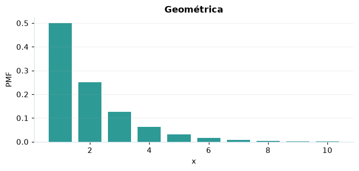

# Geométrica

## Definición formal

Cuenta los **intentos hasta** el primer éxito independiente con probabilidad $p$.

## Parámetros y rango

| Parámetro | Significado | Valores admitidos | Ejemplo |
|---|---|---|---|
| `p` | Probabilidad de éxito | > 0 y ≤ 1 | 0,5 |

## Función de masa (PMF)

$$
P(X=x)=p(1-p)^{x-1},\quad x=1,2,\ldots
$$

## Función de distribución acumulada (CDF)

$$
F(x)=\begin{cases}0,&x<1\\1-(1-p)^{\lfloor x\rfloor},&x\ge1\end{cases}
$$

La acumulada $F(x)=P(X\le x)$ suma las masas hasta $x$. Para enteros $a\le b$, $P(a\le X\le b)=F(b)-F(a-1)$.

## Media, varianza y desviación estándar

$$
\begin{aligned}\operatorname{E}[X]&=\frac1p\\[4pt]\operatorname{Var}(X)&=\frac{1-p}{p^2}\\[4pt]\sigma_X&=\sqrt{\operatorname{Var}(X)}\end{aligned}
$$

## Propiedades y casos especiales

Es la única distribución discreta sin memoria: $P(X>s+t\mid X>s)=P(X>t)$. Para $p=1$, $X=1$.

*Figura 1. Geométrica: representación ilustrativa de la función de masa.*

## Ejemplo resuelto, paso a paso

1. **Datos.** Usa `p` = 0,5 y evalúa el punto $x=5$.
2. **Sustitución.** $P(X=5)=(0{,}5)(0{,}5)^4$. La masa es **0,03125**.
3. **Acumulada.** $F(5)=P(X\le 5)$ ≈ **0,96875**.
4. **Interpretación.** La masa del paso 2 es la probabilidad de observar exactamente 5. La acumulada incluye también todos los valores menores.

## Referencias

- Ross, S. M. (2019). *A First Course in Probability* (10.ª ed.). Pearson.
- Casella, G., & Berger, R. L. (2002). *Statistical Inference* (2.ª ed.). Duxbury.
- Virtanen, P., et al. (2020). SciPy 1.0: Fundamental algorithms for scientific computing in Python. *Nature Methods, 17*, 261–272. https://doi.org/10.1038/s41592-019-0686-2
