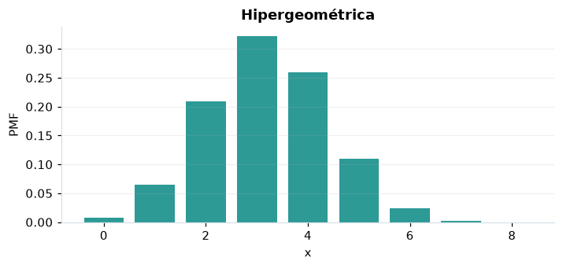

# Hipergeométrica

## Definición formal

Cuenta éxitos en $n$ extracciones **sin reemplazo** de una población de $N$ con $K$ éxitos.

## Parámetros y rango

| Parámetro | Significado | Valores admitidos | Ejemplo |
|---|---|---|---|
| `N` | Tamaño de la población | Entero, ≥ 1 | 30 |
| `K` | Éxitos en la población | Entero, ≥ 0 | 12 |
| `n` | Tamaño de la muestra | Entero, ≥ 0 | 8 |

Además, $K\le N$ y $n\le N$; todos los tamaños son enteros.

## Función de masa (PMF)

$$
P(X=x)=\frac{\binom Kx\binom{N-K}{n-x}}{\binom Nn}
$$

## Función de distribución acumulada (CDF)

$$
F(x)=\sum_{j=\max(0,n-N+K)}^{\lfloor x\rfloor}\frac{\binom Kj\binom{N-K}{n-j}}{\binom Nn}
$$

Si $N=1$, la población no tiene variación y la varianza es 0.

La acumulada $F(x)=P(X\le x)$ suma las masas hasta $x$. Para enteros $a\le b$, $P(a\le X\le b)=F(b)-F(a-1)$.

## Media, varianza y desviación estándar

$$
\begin{aligned}\operatorname{E}[X]&=n\frac KN\\[4pt]\operatorname{Var}(X)&=n\frac KN\left(1-\frac KN\right)\frac{N-n}{N-1}\\[4pt]\sigma_X&=\sqrt{\operatorname{Var}(X)}\end{aligned}
$$

## Propiedades y casos especiales

Soporte: $\max(0,n-N+K)\le x\le\min(n,K)$. La corrección $\frac{N-n}{N-1}$ cuantifica la falta de reemplazo; con $N=1$ la varianza es 0.

*Figura 1. Hipergeométrica: representación ilustrativa de la función de masa.*

## Ejemplo resuelto, paso a paso

1. **Datos.** Usa `N` = 30, `K` = 12, `n` = 8 y evalúa el punto $x=3$.
2. **Sustitución.** $P(X=3)=\frac{\binom{12}{3}\binom{18}{5}}{\binom{30}{8}}$. La masa es **0,322054**.
3. **Acumulada.** $F(3)=P(X\le 3)$ ≈ **0,604113**.
4. **Interpretación.** La masa del paso 2 es la probabilidad de observar exactamente 3. La acumulada incluye también todos los valores menores.

## Referencias

- Ross, S. M. (2019). *A First Course in Probability* (10.ª ed.). Pearson.
- Casella, G., & Berger, R. L. (2002). *Statistical Inference* (2.ª ed.). Duxbury.
- Virtanen, P., et al. (2020). SciPy 1.0: Fundamental algorithms for scientific computing in Python. *Nature Methods, 17*, 261–272. https://doi.org/10.1038/s41592-019-0686-2
