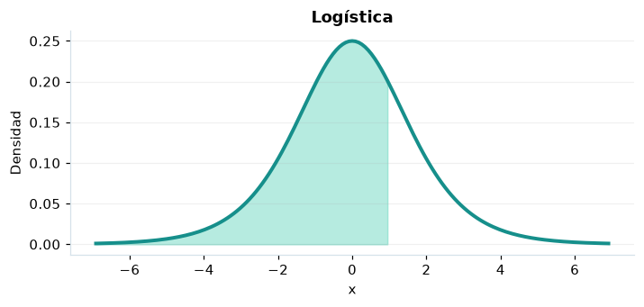

# Logística

## Definición formal

Distribución simétrica con ubicación $\mu$ y escala $s$, de colas más pesadas que la normal.

## Parámetros y rango

| Parámetro | Significado | Valores admitidos | Ejemplo |
|---|---|---|---|
| `mu` | Ubicación | Real finito | 0 |
| `escala` | Escala | > 0 | 1 |

## Función de densidad (PDF)

$$
f(x)=\frac{e^{-(x-\mu)/s}}{s[1+e^{-(x-\mu)/s}]^2}
$$

## Función de distribución acumulada (CDF)

$$
F(x)=\frac{1}{1+e^{-(x-\mu)/s}}
$$

La acumulada es $F(x)=P(X\le x)$. Para un intervalo, $P(a\le X\le b)=F(b)-F(a)$. La densidad $f(x)$ no es una probabilidad puntual: $P(X=x)=0$.

## Media, varianza y desviación estándar

$$
\begin{aligned}\operatorname{E}[X]&=\mu\\[4pt]\operatorname{Var}(X)&=\frac{\pi^2s^2}{3}\\[4pt]\sigma_X&=\sqrt{\operatorname{Var}(X)}\end{aligned}
$$

## Propiedades y casos especiales

El logit de una probabilidad uniforme tiene distribución logística estándar. CDF y función logística coinciden.

*Figura 1. Logística: representación ilustrativa de la función de densidad.*

## Ejemplo resuelto, paso a paso

1. **Datos.** Usa `mu` = 0, `escala` = 1 y evalúa el punto $x=1$.
2. **Sustitución.** $f(1)=e^{-1}/(1+e^{-1})^2$. La densidad es **0,196612**.
3. **Acumulada.** $F(1)=P(X\le 1)$ ≈ **0,731059**.
4. **Interpretación.** La probabilidad de no superar 1 es aproximadamente 73,11 %. Para una probabilidad entre dos puntos, resta sus acumuladas.

## Referencias

- Ross, S. M. (2019). *A First Course in Probability* (10.ª ed.). Pearson.
- Casella, G., & Berger, R. L. (2002). *Statistical Inference* (2.ª ed.). Duxbury.
- Virtanen, P., et al. (2020). SciPy 1.0: Fundamental algorithms for scientific computing in Python. *Nature Methods, 17*, 261–272. https://doi.org/10.1038/s41592-019-0686-2
