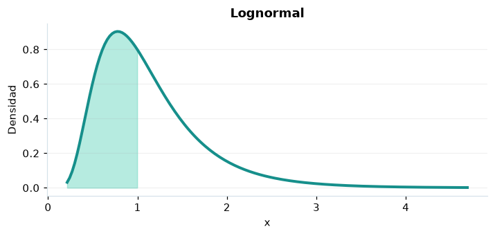

# Lognormal

## Definición formal

Variable positiva cuyo logaritmo natural es normal con media $\mu$ y desviación $\sigma$.

## Parámetros y rango

| Parámetro | Significado | Valores admitidos | Ejemplo |
|---|---|---|---|
| `mu` | Media de log(X) | Real finito | 0 |
| `sigma` | Desviación de log(X) | > 0 | 0,5 |

## Función de densidad (PDF)

$$
f(x)=\frac{1}{x\sigma\sqrt{2\pi}}\exp\left[-\frac{(\ln x-\mu)^2}{2\sigma^2}\right],\quad x>0
$$

## Función de distribución acumulada (CDF)

$$
F(x)=\Phi\left(\frac{\ln x-\mu}{\sigma}\right),\quad x>0
$$

La acumulada es $F(x)=P(X\le x)$. Para un intervalo, $P(a\le X\le b)=F(b)-F(a)$. La densidad $f(x)$ no es una probabilidad puntual: $P(X=x)=0$.

## Media, varianza y desviación estándar

$$
\begin{aligned}\operatorname{E}[X]&=e^{\mu+\sigma^2/2}\\[4pt]\operatorname{Var}(X)&=(e^{\sigma^2}-1)e^{2\mu+\sigma^2}\\[4pt]\sigma_X&=\sqrt{\operatorname{Var}(X)}\end{aligned}
$$

## Propiedades y casos especiales

La mediana es $e^\mu$, no coincide con la media. Para $x\le0$ la CDF es cero.

*Figura 1. Lognormal: representación ilustrativa de la función de densidad.*

## Ejemplo resuelto, paso a paso

1. **Datos.** Usa `mu` = 0, `sigma` = 0,5 y evalúa el punto $x=1$.
2. **Sustitución.** $f(1)=1/[0{,}5\sqrt{2\pi}]$. La densidad es **0,797885**.
3. **Acumulada.** $F(1)=P(X\le 1)$ ≈ **0,5**.
4. **Interpretación.** La probabilidad de no superar 1 es aproximadamente 50 %. Para una probabilidad entre dos puntos, resta sus acumuladas.

## Referencias

- Ross, S. M. (2019). *A First Course in Probability* (10.ª ed.). Pearson.
- Casella, G., & Berger, R. L. (2002). *Statistical Inference* (2.ª ed.). Duxbury.
- Virtanen, P., et al. (2020). SciPy 1.0: Fundamental algorithms for scientific computing in Python. *Nature Methods, 17*, 261–272. https://doi.org/10.1038/s41592-019-0686-2
