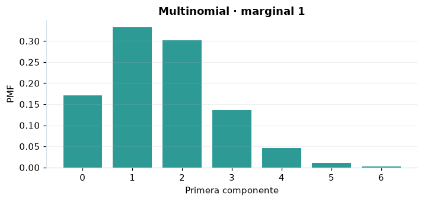

# Multinomial

## Definición formal

Generaliza la binomial a $k$ categorías, con vector de conteos $\boldsymbol X$ y $\sum_i X_i=n$.

## Parámetros y rango

| Parámetro | Significado | Valores admitidos | Ejemplo |
|---|---|---|---|
| `n` | Número total de ensayos | Entero, ≥ 0 | 8 |
| `p` | Probabilidades de las categorías (suman 1) | Cada componente: ≥ 0 y ≤ 1 | (0,2; 0,3; 0,5) |

Las probabilidades deben sumar 1. El vector observado contiene enteros no negativos que suman $n$. En los campos vectoriales separa los componentes con espacios: `0,2 0,3 0,5`.

## Función de masa (PMF)

$$
P(\boldsymbol X=\boldsymbol x)=\begin{cases}\dfrac{n!}{\prod_{i=1}^{k}x_i!}\prod_{i=1}^{k}p_i^{x_i},&\sum_i x_i=n\\0,&\mathrm{en\ otro\ caso}\end{cases}
$$

## Función de distribución acumulada (CDF)

$$
F_i(t)=P(X_i\le t)=\sum_{j=0}^{\lfloor t\rfloor}\binom nj p_i^j(1-p_i)^{n-j}
$$

Cada $F_i(t)=P(X_i\le t)$ es una **acumulada marginal**. No es la acumulada conjunta del vector.

## Media, varianza y desviación estándar

$$
\begin{aligned}\operatorname{E}[X_i]&=np_i\\[4pt]\operatorname{Var}(X_i)&=np_i(1-p_i)\\[4pt]\sigma_{X_i}&=\sqrt{\operatorname{Var}(X_i)}\end{aligned}
$$

Los momentos se interpretan **por componente**; la dependencia entre componentes se describe mediante sus covarianzas.

## Propiedades y casos especiales

La CDF y PPF que muestra AmPu son **marginales** por categoría, no conjuntas. $\operatorname{Cov}(X_i,X_j)=-np_ip_j$ para $i\ne j$. Se exige $\sum p_i=1$.

*Figura 1. Primera marginal de Multinomial; no representa la función conjunta.*

## Ejemplo resuelto, paso a paso

1. **Datos.** Usa `n` = 8, `p` = (0,2; 0,3; 0,5) y evalúa el punto $\boldsymbol{x}=\left(2;\,2;\,4\right)$.
2. **Sustitución.** $P(\boldsymbol{X}=\boldsymbol{x})=\frac{8!}{2!2!4!}(0{,}2)^2(0{,}3)^2(0{,}5)^4$. La masa conjunta es **0,0945**.
3. **Acumulada.** Las acumuladas marginales, en el orden de los componentes, son **(0,796918; 0,551774; 0,636719)**.
4. **Interpretación.** La función del paso 2 es conjunta; las acumuladas del paso 3 son marginales. No las multipliques como si los componentes fueran independientes.

## Referencias

- Ross, S. M. (2019). *A First Course in Probability* (10.ª ed.). Pearson.
- Casella, G., & Berger, R. L. (2002). *Statistical Inference* (2.ª ed.). Duxbury.
- Virtanen, P., et al. (2020). SciPy 1.0: Fundamental algorithms for scientific computing in Python. *Nature Methods, 17*, 261–272. https://doi.org/10.1038/s41592-019-0686-2
