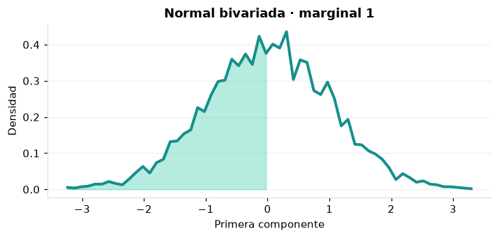

# Normal bivariada

## Definición formal

Par $(X,Y)$ normal con medias, desviaciones y correlación $\rho$; $|\rho|<1$.

## Parámetros y rango

| Parámetro | Significado | Valores admitidos | Ejemplo |
|---|---|---|---|
| `mu_x` | Media de X | Real finito | 0 |
| `mu_y` | Media de Y | Real finito | 0 |
| `sigma_x` | Desviación de X | > 0 | 1 |
| `sigma_y` | Desviación de Y | > 0 | 1 |
| `rho` | Correlación | > -1 y < 1 | 0,4 |

## Función de densidad (PDF)

$$
f(x,y)=\frac{\exp\!\left[-\frac{z_x^2-2\rho z_xz_y+z_y^2}{2(1-\rho^2)}\right]}{2\pi\sigma_x\sigma_y\sqrt{1-\rho^2}},\quad z_i=\frac{x_i-\mu_i}{\sigma_i}
$$

## Función de distribución acumulada (CDF)

$$
F(x,y)=\int_{-\infty}^{x}\int_{-\infty}^{y}f(u,v)\,\mathrm{d}v\,\mathrm{d}u
$$

La acumulada es conjunta: $F(x,y)=P(X\le x,\,Y\le y)$. No equivale al producto de las marginales salvo que $\rho=0$.

## Media, varianza y desviación estándar

$$
\begin{aligned}\operatorname{E}[\boldsymbol X]&=(\mu_x,\mu_y)\\[4pt]\operatorname{Var}(X)&=\sigma_x^2,\quad\operatorname{Var}(Y)=\sigma_y^2\\[4pt]\sigma_{X_i}&=\sqrt{\operatorname{Var}(X_i)}\end{aligned}
$$

Los momentos se interpretan **por componente**; la dependencia entre componentes se describe mediante sus covarianzas.

## Propiedades y casos especiales

La CDF es **conjunta**; los cuantiles PPF son marginales. $\operatorname{Cov}(X,Y)=\rho\sigma_x\sigma_y$.

*Figura 1. Primera marginal de Normal bivariada; no representa la función conjunta.*

## Ejemplo resuelto, paso a paso

1. **Datos.** Usa `mu_x` = 0, `mu_y` = 0, `sigma_x` = 1, `sigma_y` = 1, `rho` = 0,4 y evalúa el punto $\boldsymbol{x}=\left(0;\,0\right)$.
2. **Sustitución.** $f(0;0)=1/[2\pi\sqrt{1-0{,}4^2}]$. La densidad es **0,173652**.
3. **Acumulada.** $F(0;0)=P(X\le0,\,Y\le0)$ ≈ **0,315495**.
4. **Interpretación.** La probabilidad de que ambas variables no superen 0 es aproximadamente 31,55 %. La densidad conjunta del paso 2 no es una probabilidad.

## Referencias

- Ross, S. M. (2019). *A First Course in Probability* (10.ª ed.). Pearson.
- Casella, G., & Berger, R. L. (2002). *Statistical Inference* (2.ª ed.). Duxbury.
- Virtanen, P., et al. (2020). SciPy 1.0: Fundamental algorithms for scientific computing in Python. *Nature Methods, 17*, 261–272. https://doi.org/10.1038/s41592-019-0686-2
