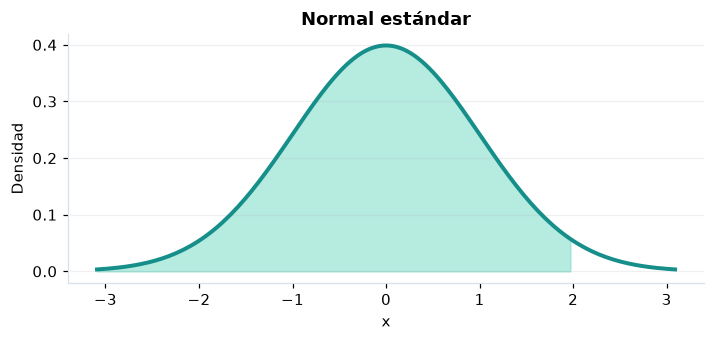

# Normal estándar

## Definición formal

Distribución normal de media 0 y varianza 1, conocida como campana de Gauss.

## Parámetros y rango

| Parámetro | Significado | Valores admitidos | Ejemplo |
|---|---|---|---|
| — | Modelo sin parámetros libres | — | — |

## Función de densidad (PDF)

$$
\varphi(z)=\frac{1}{\sqrt{2\pi}}e^{-z^2/2},\quad z\in\mathbb R
$$

## Función de distribución acumulada (CDF)

$$
\Phi(z)=\int_{-\infty}^{z}\varphi(t)\,\mathrm{d}t
$$

La acumulada es $F(x)=P(X\le x)$. Para un intervalo, $P(a\le X\le b)=F(b)-F(a)$. La densidad $f(x)$ no es una probabilidad puntual: $P(X=x)=0$.

## Media, varianza y desviación estándar

$$
\begin{aligned}\operatorname{E}[Z]&=0\\[4pt]\operatorname{Var}(Z)&=1\\[4pt]\sigma_Z&=1\end{aligned}
$$

## Propiedades y casos especiales

Es simétrica: $\Phi(-z)=1-\Phi(z)$. Si $X\sim N(\mu,\sigma^2)$, entonces $(X-\mu)/\sigma\sim N(0,1)$.

*Figura 1. Normal estándar: representación ilustrativa de la función de densidad.*

## Ejemplo resuelto, paso a paso

1. **Datos.** Usa la normal estándar, sin parámetros libres y evalúa el punto $x=2$.
2. **Sustitución.** $f(2)=e^{-2}/\sqrt{2\pi}$. La densidad es **0,053991**.
3. **Acumulada.** $F(2)=P(X\le 2)$ ≈ **0,97725**.
4. **Interpretación.** La probabilidad de no superar 2 es aproximadamente 97,72 %. Para una probabilidad entre dos puntos, resta sus acumuladas.

## Referencias

- Ross, S. M. (2019). *A First Course in Probability* (10.ª ed.). Pearson.
- Casella, G., & Berger, R. L. (2002). *Statistical Inference* (2.ª ed.). Duxbury.
- Virtanen, P., et al. (2020). SciPy 1.0: Fundamental algorithms for scientific computing in Python. *Nature Methods, 17*, 261–272. https://doi.org/10.1038/s41592-019-0686-2
