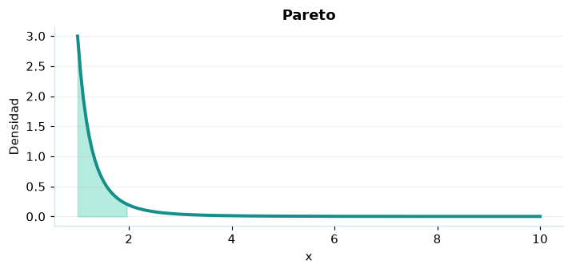

# Pareto

## Definición formal

Modelo de cola de potencia para valores superiores a un mínimo $x_m$.

## Parámetros y rango

| Parámetro | Significado | Valores admitidos | Ejemplo |
|---|---|---|---|
| `alpha` | Forma α | > 0 | 3 |
| `xmin` | Mínimo xₘ | > 0 | 1 |

## Función de densidad (PDF)

$$
f(x)=\frac{\alpha x_m^\alpha}{x^{\alpha+1}},\quad x\ge x_m
$$

## Función de distribución acumulada (CDF)

$$
F(x)=\begin{cases}0,&x<x_m\\1-(x_m/x)^\alpha,&x\ge x_m\end{cases}
$$

La acumulada es $F(x)=P(X\le x)$. Para un intervalo, $P(a\le X\le b)=F(b)-F(a)$. La densidad $f(x)$ no es una probabilidad puntual: $P(X=x)=0$.

## Media, varianza y desviación estándar

$$
\begin{aligned}\operatorname{E}[X]&=\frac{\alpha x_m}{\alpha-1}\ (\alpha>1)\\[4pt]\operatorname{Var}(X)&=\frac{\alpha x_m^2}{(\alpha-1)^2(\alpha-2)}\ (\alpha>2)\\[4pt]\sigma_X&=\sqrt{\operatorname{Var}(X)}\end{aligned}
$$

Los momentos solo existen bajo las condiciones indicadas; si la varianza no existe, la desviación estándar tampoco está definida.

## Propiedades y casos especiales

La media diverge si $\alpha\le1$ y la varianza si $\alpha\le2$. Multiplicar $x_m$ solo cambia la escala.

*Figura 1. Pareto: representación ilustrativa de la función de densidad.*

## Ejemplo resuelto, paso a paso

1. **Datos.** Usa `alpha` = 3, `xmin` = 1 y evalúa el punto $x=2$.
2. **Sustitución.** $f(2)=3/2^4$. La densidad es **0,1875**.
3. **Acumulada.** $F(2)=P(X\le 2)$ ≈ **0,875**.
4. **Interpretación.** La probabilidad de no superar 2 es aproximadamente 87,5 %. Para una probabilidad entre dos puntos, resta sus acumuladas.

## Referencias

- Ross, S. M. (2019). *A First Course in Probability* (10.ª ed.). Pearson.
- Casella, G., & Berger, R. L. (2002). *Statistical Inference* (2.ª ed.). Duxbury.
- Virtanen, P., et al. (2020). SciPy 1.0: Fundamental algorithms for scientific computing in Python. *Nature Methods, 17*, 261–272. https://doi.org/10.1038/s41592-019-0686-2
