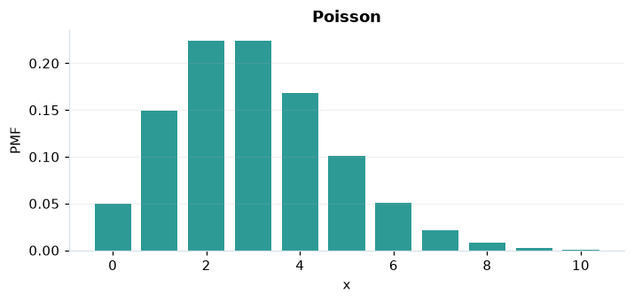

# Poisson

## Definición formal

Número de sucesos en un intervalo, con tasa media $\lambda$ y ocurrencias independientes.

## Parámetros y rango

| Parámetro | Significado | Valores admitidos | Ejemplo |
|---|---|---|---|
| `tasa` | Eventos esperados por intervalo (λ) | ≥ 0 | 3 |

## Función de masa (PMF)

$$
P(X=x)=e^{-\lambda}\frac{\lambda^x}{x!},\quad x=0,1,\ldots
$$

## Función de distribución acumulada (CDF)

$$
F(x)=e^{-\lambda}\sum_{k=0}^{\lfloor x\rfloor}\frac{\lambda^k}{k!}
$$

La acumulada $F(x)=P(X\le x)$ suma las masas hasta $x$. Para enteros $a\le b$, $P(a\le X\le b)=F(b)-F(a-1)$.

## Media, varianza y desviación estándar

$$
\begin{aligned}\operatorname{E}[X]&=\lambda\\[4pt]\operatorname{Var}(X)&=\lambda\\[4pt]\sigma_X&=\sqrt{\operatorname{Var}(X)}\end{aligned}
$$

## Propiedades y casos especiales

Si $\lambda=0$, toda la masa está en 0. Aproxima una binomial cuando $n$ es grande, $p$ pequeño y $np=\lambda$.

*Figura 1. Poisson: representación ilustrativa de la función de masa.*

## Ejemplo resuelto, paso a paso

1. **Datos.** Usa `tasa` = 3 y evalúa el punto $x=5$.
2. **Sustitución.** $P(X=5)=e^{-3}3^5/5!$. La masa es **0,100819**.
3. **Acumulada.** $F(5)=P(X\le 5)$ ≈ **0,916082**.
4. **Interpretación.** La masa del paso 2 es la probabilidad de observar exactamente 5. La acumulada incluye también todos los valores menores.

## Referencias

- Ross, S. M. (2019). *A First Course in Probability* (10.ª ed.). Pearson.
- Casella, G., & Berger, R. L. (2002). *Statistical Inference* (2.ª ed.). Duxbury.
- Virtanen, P., et al. (2020). SciPy 1.0: Fundamental algorithms for scientific computing in Python. *Nature Methods, 17*, 261–272. https://doi.org/10.1038/s41592-019-0686-2
