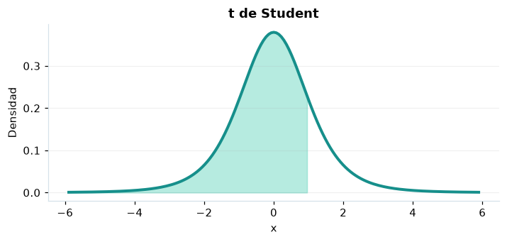

# t de Student

## Definición formal

Cociente de una normal estándar y la raíz de una chi-cuadrado independiente dividida por $\nu$.

## Parámetros y rango

| Parámetro | Significado | Valores admitidos | Ejemplo |
|---|---|---|---|
| `gl` | Grados de libertad | > 0 | 5 |

## Función de densidad (PDF)

$$
f(x)=\frac{\Gamma((\nu+1)/2)}{\sqrt{\nu\pi}\,\Gamma(\nu/2)}\left(1+\frac{x^2}{\nu}\right)^{-(\nu+1)/2}
$$

## Función de distribución acumulada (CDF)

$$
F(x)=\int_{-\infty}^{x}f(t)\,\mathrm{d}t
$$

La acumulada es $F(x)=P(X\le x)$. Para un intervalo, $P(a\le X\le b)=F(b)-F(a)$. La densidad $f(x)$ no es una probabilidad puntual: $P(X=x)=0$.

## Media, varianza y desviación estándar

$$
\begin{aligned}\operatorname{E}[X]&=0\ (\nu>1)\\[4pt]\operatorname{Var}(X)&=\frac\nu{\nu-2}\ (\nu>2)\\[4pt]\sigma_X&=\sqrt{\operatorname{Var}(X)}\end{aligned}
$$

Los momentos solo existen bajo las condiciones indicadas; si la varianza no existe, la desviación estándar tampoco está definida.

## Propiedades y casos especiales

Para $\nu=1$ es Cauchy, sin media ni varianza; para $1<\nu\le2$ no hay varianza. Al crecer $\nu$ tiende a la normal.

*Figura 1. t de Student: representación ilustrativa de la función de densidad.*

## Ejemplo resuelto, paso a paso

1. **Datos.** Usa `gl` = 5 y evalúa el punto $x=1$.
2. **Sustitución.** $f(1)=\frac{\Gamma(3)}{\sqrt{5\pi}\,\Gamma(5/2)}(6/5)^{-3}$. La densidad es **0,21968**.
3. **Acumulada.** $F(1)=P(X\le 1)$ ≈ **0,818391**.
4. **Interpretación.** La probabilidad de no superar 1 es aproximadamente 81,84 %. Para una probabilidad entre dos puntos, resta sus acumuladas.

## Referencias

- Ross, S. M. (2019). *A First Course in Probability* (10.ª ed.). Pearson.
- Casella, G., & Berger, R. L. (2002). *Statistical Inference* (2.ª ed.). Duxbury.
- Virtanen, P., et al. (2020). SciPy 1.0: Fundamental algorithms for scientific computing in Python. *Nature Methods, 17*, 261–272. https://doi.org/10.1038/s41592-019-0686-2
