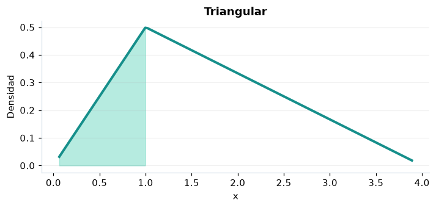

# Triangular

## Definición formal

Distribución acotada definida por mínimo $a$, máximo $b$ y moda $c$ con $a\le c\le b$.

## Parámetros y rango

| Parámetro | Significado | Valores admitidos | Ejemplo |
|---|---|---|---|
| `a` | Límite inferior | Real finito | 0 |
| `b` | Límite superior | Real finito | 4 |
| `c` | Moda dentro de [a,b] | Real finito | 1 |

Los parámetros deben cumplir $a<b$ y $a\le c\le b$.

## Función de densidad (PDF)

$$
f(x)=\begin{cases}\frac{2(x-a)}{(b-a)(c-a)},&a\le x<c\\\frac{2(b-x)}{(b-a)(b-c)},&c\le x\le b\\0,&\mathrm{en\ otro\ caso}\end{cases}
$$

## Función de distribución acumulada (CDF)

$$
F(x)=\begin{cases}0,&x<a\\\frac{(x-a)^2}{(b-a)(c-a)},&a\le x<c\\1-\frac{(b-x)^2}{(b-a)(b-c)},&c\le x\le b\\1,&x>b\end{cases}
$$

La acumulada es $F(x)=P(X\le x)$. Para un intervalo, $P(a\le X\le b)=F(b)-F(a)$. La densidad $f(x)$ no es una probabilidad puntual: $P(X=x)=0$.

## Media, varianza y desviación estándar

$$
\begin{aligned}\operatorname{E}[X]&=\frac{a+b+c}{3}\\[4pt]\operatorname{Var}(X)&=\frac{a^2+b^2+c^2-ab-ac-bc}{18}\\[4pt]\sigma_X&=\sqrt{\operatorname{Var}(X)}\end{aligned}
$$

## Propiedades y casos especiales

Si $c=a$ o $c=b$, se interpreta la expresión por su límite; la moda está en un extremo.

*Figura 1. Triangular: representación ilustrativa de la función de densidad.*

## Ejemplo resuelto, paso a paso

1. **Datos.** Usa `a` = 0, `b` = 4, `c` = 1 y evalúa el punto $x=1$.
2. **Sustitución.** $f(1)=\frac{2(1-0)}{(4-0)(1-0)}$. La densidad es **0,5**.
3. **Acumulada.** $F(1)=P(X\le 1)$ ≈ **0,25**.
4. **Interpretación.** La probabilidad de no superar 1 es aproximadamente 25 %. Para una probabilidad entre dos puntos, resta sus acumuladas.

## Referencias

- Ross, S. M. (2019). *A First Course in Probability* (10.ª ed.). Pearson.
- Casella, G., & Berger, R. L. (2002). *Statistical Inference* (2.ª ed.). Duxbury.
- Virtanen, P., et al. (2020). SciPy 1.0: Fundamental algorithms for scientific computing in Python. *Nature Methods, 17*, 261–272. https://doi.org/10.1038/s41592-019-0686-2
