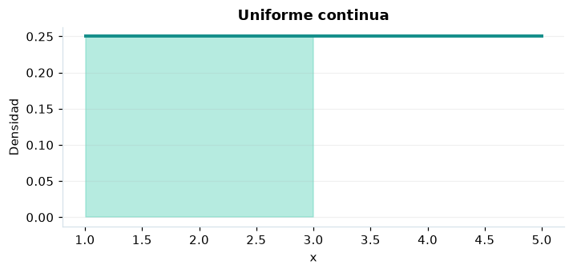

# Uniforme continua

## Definición formal

Una variable continua con densidad constante en el intervalo $[a,b]$.

## Parámetros y rango

| Parámetro | Significado | Valores admitidos | Ejemplo |
|---|---|---|---|
| `a` | Extremo inferior | Real finito | 1 |
| `b` | Extremo superior | Real finito | 5 |

Los extremos deben cumplir $a<b$.

## Función de densidad (PDF)

$$
f(x)=\begin{cases}\dfrac1{b-a},&a\le x\le b\\0,&\mathrm{en\ otro\ caso}\end{cases}
$$

## Función de distribución acumulada (CDF)

$$
F(x)=\begin{cases}0,&x<a\\\dfrac{x-a}{b-a},&a\le x\le b\\1,&x>b\end{cases}
$$

La acumulada es $F(x)=P(X\le x)$. Para un intervalo, $P(a\le X\le b)=F(b)-F(a)$. La densidad $f(x)$ no es una probabilidad puntual: $P(X=x)=0$.

## Media, varianza y desviación estándar

$$
\begin{aligned}\operatorname{E}[X]&=\frac{a+b}{2}\\[4pt]\operatorname{Var}(X)&=\frac{(b-a)^2}{12}\\[4pt]\sigma_X&=\sqrt{\operatorname{Var}(X)}\end{aligned}
$$

## Propiedades y casos especiales

La probabilidad de un punto aislado es cero; se calcula el área entre extremos. Sustituye el error original $a+b$ por $b-a$ en la desviación.

*Figura 1. Uniforme continua: representación ilustrativa de la función de densidad.*

## Ejemplo resuelto, paso a paso

1. **Datos.** Usa `a` = 1, `b` = 5 y evalúa el punto $x=3$.
2. **Sustitución.** $f(3)=1/(5-1)$. La densidad es **0,25**.
3. **Acumulada.** $F(3)=P(X\le 3)$ ≈ **0,5**.
4. **Interpretación.** La probabilidad de no superar 3 es aproximadamente 50 %. Para una probabilidad entre dos puntos, resta sus acumuladas.

## Referencias

- Ross, S. M. (2019). *A First Course in Probability* (10.ª ed.). Pearson.
- Casella, G., & Berger, R. L. (2002). *Statistical Inference* (2.ª ed.). Duxbury.
- Virtanen, P., et al. (2020). SciPy 1.0: Fundamental algorithms for scientific computing in Python. *Nature Methods, 17*, 261–272. https://doi.org/10.1038/s41592-019-0686-2
