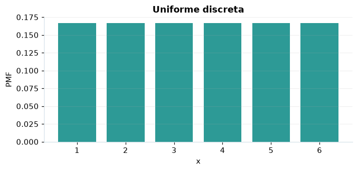

# Uniforme discreta

## Definición formal

Cada entero entre $a$ y $b$, ambos incluidos, tiene idéntica probabilidad.

## Parámetros y rango

| Parámetro | Significado | Valores admitidos | Ejemplo |
|---|---|---|---|
| `a` | Primer entero | Entero | 1 |
| `b` | Último entero incluido | Entero | 6 |

Los extremos deben ser enteros y cumplir $a\le b$.

## Función de masa (PMF)

$$
P(X=x)=\begin{cases}\dfrac{1}{b-a+1},&x\in\{a,\ldots,b\}\\0,&\mathrm{en\ otro\ caso}\end{cases}
$$

## Función de distribución acumulada (CDF)

$$
F(x)=\begin{cases}0,&x<a\\\dfrac{\lfloor x\rfloor-a+1}{b-a+1},&a\le x<b\\1,&x\ge b\end{cases}
$$

La acumulada $F(x)=P(X\le x)$ suma las masas hasta $x$. Para enteros $a\le b$, $P(a\le X\le b)=F(b)-F(a-1)$.

## Media, varianza y desviación estándar

$$
\begin{aligned}\operatorname{E}[X]&=\frac{a+b}{2}\\[4pt]\operatorname{Var}(X)&=\frac{(b-a+1)^2-1}{12}\\[4pt]\sigma_X&=\sqrt{\operatorname{Var}(X)}\end{aligned}
$$

## Propiedades y casos especiales

Cuando $a=b$ es una masa puntual. Para $a=1$ y $b=6$ representa un dado ideal.

*Figura 1. Uniforme discreta: representación ilustrativa de la función de masa.*

## Ejemplo resuelto, paso a paso

1. **Datos.** Usa `a` = 1, `b` = 6 y evalúa el punto $x=3$.
2. **Sustitución.** $P(X=3)=1/(6-1+1)$. La masa es **0,166667**.
3. **Acumulada.** $F(3)=P(X\le 3)$ ≈ **0,5**.
4. **Interpretación.** La masa del paso 2 es la probabilidad de observar exactamente 3. La acumulada incluye también todos los valores menores.

## Referencias

- Ross, S. M. (2019). *A First Course in Probability* (10.ª ed.). Pearson.
- Casella, G., & Berger, R. L. (2002). *Statistical Inference* (2.ª ed.). Duxbury.
- Virtanen, P., et al. (2020). SciPy 1.0: Fundamental algorithms for scientific computing in Python. *Nature Methods, 17*, 261–272. https://doi.org/10.1038/s41592-019-0686-2
