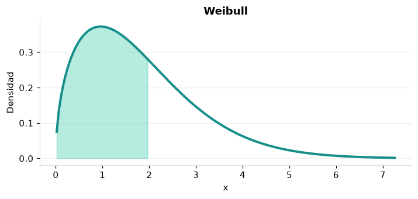

# Weibull

## Definición formal

Modelo de duración no negativa con forma $k$ y escala $\lambda$.

## Parámetros y rango

| Parámetro | Significado | Valores admitidos | Ejemplo |
|---|---|---|---|
| `forma` | Forma k | > 0 | 1,5 |
| `escala` | Escala λ | > 0 | 2 |

## Función de densidad (PDF)

$$
f(x)=\frac{k}{\lambda}\left(\frac{x}{\lambda}\right)^{k-1}e^{-(x/\lambda)^k},\quad x\ge0
$$

## Función de distribución acumulada (CDF)

$$
F(x)=1-e^{-(x/\lambda)^k},\quad x\ge0
$$

La acumulada es $F(x)=P(X\le x)$. Para un intervalo, $P(a\le X\le b)=F(b)-F(a)$. La densidad $f(x)$ no es una probabilidad puntual: $P(X=x)=0$.

## Media, varianza y desviación estándar

$$
\begin{aligned}\operatorname{E}[X]&=\lambda\Gamma(1+1/k)\\[4pt]\operatorname{Var}(X)&=\lambda^2\left[\Gamma(1+2/k)-\Gamma(1+1/k)^2\right]\\[4pt]\sigma_X&=\sqrt{\operatorname{Var}(X)}\end{aligned}
$$

## Propiedades y casos especiales

$k=1$ equivale a exponencial. Riesgo decreciente para $k<1$ y creciente para $k>1$.

*Figura 1. Weibull: representación ilustrativa de la función de densidad.*

## Ejemplo resuelto, paso a paso

1. **Datos.** Usa `forma` = 1,5, `escala` = 2 y evalúa el punto $x=2$.
2. **Sustitución.** $f(2)=0{,}75e^{-1}$. La densidad es **0,27591**.
3. **Acumulada.** $F(2)=P(X\le 2)$ ≈ **0,632121**.
4. **Interpretación.** La probabilidad de no superar 2 es aproximadamente 63,21 %. Para una probabilidad entre dos puntos, resta sus acumuladas.

## Referencias

- Ross, S. M. (2019). *A First Course in Probability* (10.ª ed.). Pearson.
- Casella, G., & Berger, R. L. (2002). *Statistical Inference* (2.ª ed.). Duxbury.
- Virtanen, P., et al. (2020). SciPy 1.0: Fundamental algorithms for scientific computing in Python. *Nature Methods, 17*, 261–272. https://doi.org/10.1038/s41592-019-0686-2
